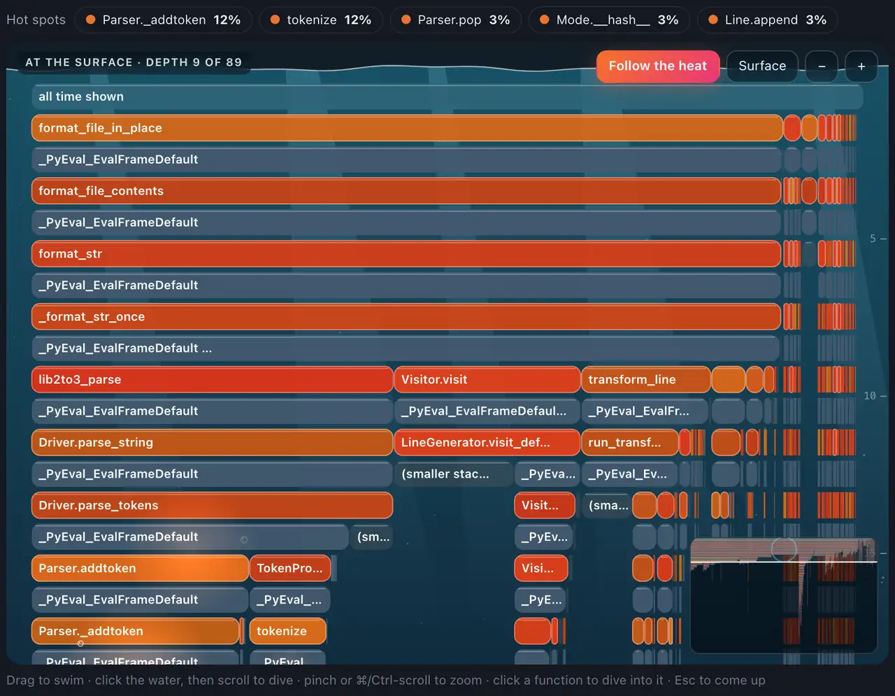
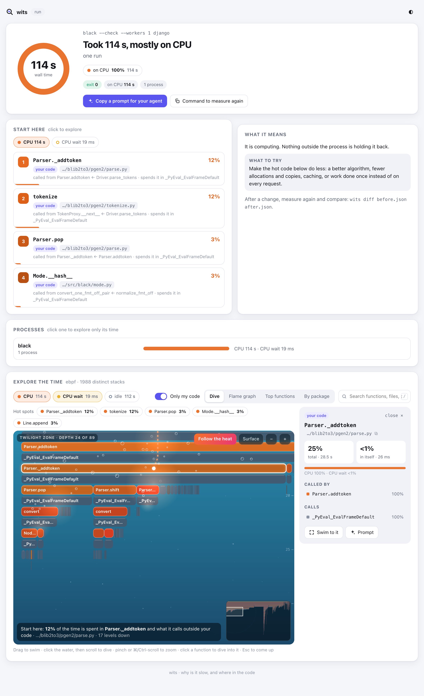

# wits

**witr tells you why it is running. wits tells you why it is slow.**

**AI coding agents:** start with [For coding agents](#for-coding-agents).

Explain why a process is slow: the cause, how much of its time it costs, the
exact file, lock or socket involved, which other process is to blame, and
where in the code the time goes. Linux and macOS, any language, one binary.
No root needed. With root it sees every user's processes, and on Linux it
uses eBPF for stacks on and off the CPU: the programs are built into wits,
with nothing to install.

[简体中文](README.zh-CN.md)




With `--html` the same answer is a page you can explore: dive down the call
tree to where the time goes ([See it](#see-it)).

`top` shows you a number. `wits` gives you the sentence you would have written
after ten minutes with `top`, `iotop`, `strace`, `lsof`, `/proc/locks` and a
profiler.

## Install

```sh
curl -fsSL https://raw.githubusercontent.com/aryehlev/wits/main/install.sh | sh
```

Or any of:

```sh
cargo install wits
cargo binstall wits
brew install aryehlev/tap/wits     # macOS and Linux
yay -S wits-bin                    # Arch (AUR)
```

Or download the binary from
[Releases](https://github.com/aryehlev/wits/releases) and put it on your
`PATH`: static for Linux on x86_64 and aarch64, and for macOS on Apple silicon
and Intel. For Kubernetes, see [below](#kubernetes). Servers need no install:
[`wits on`](#on-another-machine-in-any-cloud) asks them from here.

## Use

```sh
wits <pid|name>              # why is this process slow, and where in its code?
wits                         # which processes are waiting most right now?
wits <target> <target>...    # several at once, busiest first
wits profile <pid|name>      # every cause, with its hottest call paths
wits run -- <command...>     # run a command; where did its time go?
wits diff before.json after.json   # did my change help?
wits guide [<language>]      # what usually makes it slow in that language, and what fixes it
wits <namespace>/<pod>       # a pod: each of its processes (Linux)
wits <namespace>/<deployment>      # every replica, busiest first (Linux)
wits on <where> <any of the above> # on another machine: [user@]host, gcp:, aws:, azure:
wits mcp                     # an MCP server for coding agents
```

For example:

```console
$ wits deploy
deploy (pid 2655) is waiting for a lock: 100% of its time over the last 2.0s
  what   the file lock on /root/wits-demo/schema.lock
  blame  held by pid 2652 (migrate …/schema.lock …/warehouse 600), which is only waiting for its child pid 2654 (warehouse)

$ wits fs
fs (pid 4148) is waiting for disk: 97% of its time over the last 2.0s
  what   fsync() on /home/ubuntu/t/log.bin, device sda1 (100% busy)
  where  100% in flush_log (…/ubuntu/t/fs.c:4) ← main (…/ubuntu/t/fs.c:5)
  blame  its own I/O: it read 0 B, wrote 5.3 MB; no other visible process is doing more
  also   cpu 3%

$ wits shop/api-7d9f
python3 (pid 6723, pod shop/api-7d9f/api) is waiting for another process: 100% of its time over the last 2.0s
  what   blocked in recvfrom() on fd 3, TCP 10.20.0.1:45476 → 10.20.0.2:5432 (postgres)
  blame  pid 6719 (python3 …/server.py, pod db/pg-0/postgres), which is itself waiting for disk
```

| Option | Meaning |
| --- | --- |
| `-t, --time <secs>` | how long to watch (default 2) |
| `--json` | machine-readable output, for scripts and coding agents |
| `--no-follow` | do not descend into the child a process is waiting for |
| `--no-stacks` | do not collect stacks (no `where`) |
| `--folded` | with `profile`: folded stacks, for `flamegraph.pl`, inferno or speedscope |
| `--html <file>` | also write the answer as a web page to explore: the dive, flame graphs by cause, top functions |
| `-o <file>` | with `run`: save the report for `diff` |
| `-n <count>` | with `run`: run the command that many times |
| `--peers <list>` | wits agents on other machines to follow blame to |

If you ask about a shell or a `make` that is only waiting for a child, wits
follows the chain down and explains the child that is actually doing the
waiting. If the process is not slow at all (asleep on a timer, waiting at a
prompt, a server with no requests) wits says so instead of inventing a cause.

## What it tells you

Every answer is one of six causes, with what it is waiting on (`what`), who
is to blame (`blame`) and the code responsible (`where`).

### The six causes

| Cause | The process is… | wits names | and blames |
| --- | --- | --- | --- |
| `cpu` | busy computing; nothing is in its way | user/kernel split, hottest thread, hottest functions | itself |
| `cpu-wait` | ready to run but not given a CPU | the CPUs it may use, or its cgroup's CPU limit | the process hogging those CPUs, or the limit |
| `disk` | blocked on storage | the system call, the file, the device and how busy it is | the process doing the most I/O |
| `memory` | swapping, or evicting and re-reading its own pages | swap activity, major faults | the cgroup memory limit, or the biggest process |
| `lock` | queued on a file lock or a mutex | the locked file, or the mutex address | the process or thread holding it, and what that holder is doing |
| `peer` | waiting for another process or the network | the pipe, socket and address | the process at the other end (in any container or pod, or on another node with an agent), or the remote host |

That is the whole list. wits does not guess beyond it.

### Where in the code

The `where` line names the function, file and line responsible for the cause,
and its caller. `wits profile` shows every cause with its hottest call paths:

```console
$ sudo wits profile lockm
lockm (pid 9733) is waiting for a lock: 99% of its time over the last 2.0s
  stacks from ebpf+stack-scan

  lock 99% (2.0s)
    100%  main (…/wits/cases/lock-mutex.c:21)

  cpu 1% (12ms)
    100%  holder (…/wits/cases/lock-mutex.c:13) in clock_nanosleep

  idle, not counted (2.0s)
    100%  holder (…/wits/cases/lock-mutex.c:13)
```

Stacks are split by cause, not just by CPU time: a function that spends its
time in `fsync` shows under `disk`, one queued on a mutex under `lock`. That
is the part an on-CPU profiler cannot show you. [How it works](#how-it-works)
says how the stacks are collected.

Languages:

- **Compiled** (C, C++, Rust, Go, Zig, Swift, …): function, file and line
  from the binary's symbols and DWARF, including inlined functions. Build
  with frame pointers (`-fno-omit-frame-pointer`, Rust
  `-C force-frame-pointers=yes`) for whole stacks; Go has them by default.
  wits says so when stacks are cut short.
- **JIT and interpreters** (Node, Python 3.12+, Java, .NET, Ruby, Erlang):
  their functions show up when the runtime publishes a perf map. wits tells
  you the switch for each (`node --perf-basic-prof`, `PYTHONPERFSUPPORT=1`,
  `jcmd <pid> Compiler.perfmap`, `DOTNET_PerfMapEnabled=1`, `--yjit-perf`,
  `+JPperf true`), and `wits run` sets the environment ones for you.
- **macOS** shows native frames only: interpreted functions stay hidden.

### What kind of work it is

A hot spot says where the time is. Often the time is not in one place: every
function allocates a little, and together that is a third of the run. So wits
also sums, over every stack, the costs it knows by name, and says what each
one is. With `--json`, next to the hot spots:

```json
"code":{"lang":"go","hints":[
 {"cause":"cpu","share":0.42,"seconds":1.05,"id":"alloc-gc","lang":"go","seen":"runtime.scanobject",
  "means":"allocating memory and collecting garbage",
  "try":"Allocate less on the hot path: … As a setting, GOGC=200 or more trades memory for fewer collections; set GOMEMLIMIT with it to bound the heap."},
 {"cause":"cpu","share":0.26,"seconds":0.64,"id":"json","lang":"go","seen":"encoding/json.stateInString",
  "means":"encoding/json: JSON encoding and decoding driven by reflection",
  "try":"… Decode into typed structs, not map[string]any; … easyjson, goccy/go-json, bytedance/sonic …"}]}
```

- `lang` is the program's language, read from the stacks: `python`, `node`,
  `go`, `rust`, `jvm`, `dotnet`, `ruby`, `beam` or `c`.
- A hint is a measurement: `share` is the part of that cause's time that
  passed through those functions, and `seen` the function most of it was in.
  Hints can overlap (JSON decoding that allocates is in both).
- wits knows about seventy of them: allocation and garbage collection in
  each runtime, the interpreter's own loop, regex, JSON, reflection,
  exceptions, formatting, hashing, the GIL and contended mutexes, start-up
  and warm-up, page faults, small reads and writes, and tools left attached
  (coverage, a debugger).
- `"whole": true` marks a sign about the whole program: a Rust dev build, a
  .NET Debug build, a sanitizer, Go's race detector. Fix that first; the rest
  describes a different program.

`wits guide <language>` prints what usually makes a program in that language
slow and what usually fixes it, cheapest first: how to make the runtime show
your functions, the settings to try before touching code (`GOGC`,
`--max-semi-space-size`, `-XX:MaxRAMPercentage`, `RUBY_YJIT_ENABLE`, a
release build), what each runtime function means when it is hot, and the
usual lock, network and disk problems. `wits guide general` covers what holds
in any language: N+1 queries, connections, fsync, container limits, builds
and tests. The same text is in the
[skill](skills/why-is-this-slow/guides) and behind the `wits_guide` MCP tool.

## See it

Add `--html <file>` to any command and wits also writes its answer as one
self-contained web page you can explore:

```sh
sudo wits run --html run.html -- ./server --selftest
```

Here it is for [black](https://github.com/psf/black) checking Django's
source (`sudo env PYTHONPERFSUPPORT=1 wits run --html black.html -- black
--check --workers 1 django`):

<picture>
  <source media="(prefers-color-scheme: dark)" srcset="demo/page-dark.png">
  
</picture>

- **The answer first.** What the time went to, as a ring you can click, and
  in plain words what it means and what to try.
- **Start here.** Your hottest functions, with file and line (click to copy)
  and what they spend the time in. wits tells your code apart from
  dependencies, the language's standard library, the C library and the
  kernel, for Rust, Go, C and C++, Python, Node, Java, Ruby and .NET.
- **Dive.** The call tree as an ocean: the program starts at the surface,
  every call is a step deeper, and more time is wider. Your functions glow,
  and time bubbles up from where it is spent, fast for CPU and slowly for
  waits. **Follow the heat** swims down to where wits says to start (the
  first time you see it, it does so by itself); drag to swim, scroll to dive,
  click a function to dive into it, and the sonar shows where you are.
- **Explore.** The same time as an animated flame graph: click to zoom, hover
  to light up a function everywhere it appears, search, and **Only my code**
  to fold away the runtime between your functions. **Top functions** ranks
  them, **By package** shows whose code the time is in, and clicking any
  function shows who calls it, what it calls and its hot lines.
- **Ask your agent.** One button writes a prompt with the answer and the
  hottest code for your coding agent.

The same page shows several pods side by side, a `diff` (with what changed,
function by function), a run, or the overview. MCP hosts that support MCP
Apps show it next to wits's tool results; there it can also ask wits about
the process to blame, and look again.

For deeper work on the stacks, use the tools made for it: `wits profile
--folded <pid>` writes folded stacks, rooted at the cause (`[cpu]`, `[disk]`,
`[lock]`…), for `flamegraph.pl`, [inferno](https://github.com/jonhoo/inferno)
or [speedscope](https://www.speedscope.app).

## The improvement loop

`wits run` starts a command, watches it and everything it starts until it
exits, and reports where the time went, down to functions. Save the report,
change the code, run again, and `wits diff` tells you whether it helped,
whether the difference is beyond run-to-run noise, and which functions
changed:

```console
$ wits run -n 5 -o before.json -- ./work 400
wits: `./work 400` took 515ms (median of 5, 463ms–646ms) (exit 0); 1 process, 435ms on CPU
  cpu        91%   435ms   work 428ms
  cpu-wait    9%    44ms   work 44ms
  where     cpu: 100% in inner_loop (…/wits/cases/where.c:14) ← main (…/wits/cases/where.c:33)
saved to before.json; after a change, run it again with -o new.json and: wits diff before.json new.json

$ wits run -n 5 -o after.json -- ./work 100
$ wits diff before.json after.json
faster: 515ms → 165ms (−68%), beyond run-to-run noise (the runs do not overlap)
  on CPU    435ms → 146ms (−66%)
  cpu       435ms → 146ms (−289ms)
  cpu-wait  44ms → 19ms (−25ms)

  functions that changed most
     −302ms  inner_loop (…/wits/cases/where.c)  cpu 360ms → 58ms
```

With overlapping runs it says `no clear change … within run-to-run noise`
instead of claiming a win. With one run each it tells you to use `-n`.
`wits run` works without root: everything it starts is its own descendant.

### Choosing what to change

The best fix is the one that removes the most time for the least work. Score
each candidate:

**score = 0.7 × gain + 0.3 × ease**

- **gain** (0 to 1): the share of the measured time the change would remove.
  wits gives the upper bound: the cause's share times the hot spot's share (a
  disk cause at 96%, with 100% of it in `flush_log`, bounds a fix there at
  0.96), or times a [hint](#what-kind-of-work-it-is)'s share. A fix that
  removes half of a hot spot gets half of that.
- **ease** (0 to 1): **1** a flag, a config value or one line; **0.7** a small
  change inside one function; **0.4** several functions or files, or an API
  change; **0.1** a redesign, a new dependency or a different architecture.

| Candidate (disk 96%, all of it `fsync` in `flush_log`) | gain | ease | score |
| --- | --- | --- | --- |
| fsync once per batch of writes, not per write | 0.85 | 0.7 | **0.81** |
| rewrite the storage layer | 0.95 | 0.1 | 0.70 |
| move the file to a faster disk | 0.5 | 0.4 | 0.47 |

Make the highest-scoring change first, one at a time, and measure each with
`wits run` and `wits diff`. If the diff says `no clear change`, undo it: effort
that buys no speed is not worth keeping. The skill, the MCP server and the
page's "Ask your agent" prompt all tell coding agents to work this way and to
show you their scores next to what wits measured.

## For coding agents

If you are a coding agent and something is slow, hanging or stuck, measure
before you guess:

```sh
curl -fsSL https://raw.githubusercontent.com/aryehlev/wits/main/install.sh | sh   # one binary, no root
wits --json <pid|name>        # why is it slow: cause, object, who is to blame, function and line
wits --json                   # don't know which process? the ones waiting most right now
wits run -n 5 -o before.json -- <command...>   # before a change; again with -o after.json
wits diff --json before.json after.json        # did it help? verdict: faster | slower | no clear change
wits guide <language>         # what usually fixes it in python, node, go, rust, jvm, dotnet, ruby, beam, c
wits on <where> --json <pid|name>   # the same on another machine: [user@]host, gcp:<vm>, aws:<vm>, azure:<group>/<vm>
```

- Read `summary`, `cause`, `what`, `where` and `blame`. When `blame.kind`
  is `process`, ask wits about `blame.pid` next, until the answer is `cpu`,
  `disk`, `memory`, a cgroup limit, a remote host or an idle process.
- Read `code.lang` and `code.hints` too: the costs wits knows by name, with
  their measured share ("42% of the CPU time is allocation and garbage
  collection"), and what usually fixes each. Then read `wits guide` for that
  language before you choose a fix (see
  [What kind of work it is](#what-kind-of-work-it-is)).
- Report the `diff` verdict as it is: `no clear change` is not a speedup. Only
  repeat (`-n`) commands that are safe to run again.
- Pick fixes by **0.7 × gain + 0.3 × ease** and make the highest-scoring one
  first, one at a time (see [Choosing what to change](#choosing-what-to-change)).
- Another machine: `wits on <where> --json <pid|name>` runs wits there over
  ssh, or on a cloud VM by its name, and gives the same answer; `--sudo` to
  see other users' processes (see
  [On another machine](#on-another-machine-in-any-cloud)).
- Kubernetes: `wits --json <namespace>/<pod>` or `<namespace>/<deployment>`
  on a node, or `kubectl wits -n <namespace> deploy/<name> --json` from
  anywhere (see [Kubernetes](#kubernetes)).
- wits never changes or signals the processes it watches. Without `sudo` it
  sees only your own processes, and on Linux no on-CPU stacks.

### MCP server

`wits mcp` is an MCP server on stdin and stdout. Add it to Claude Code with

```sh
claude mcp add wits -- wits mcp
```

or to any MCP client as the command `wits` with the argument `mcp`, for
example:

```json
{ "mcpServers": { "wits": { "command": "wits", "args": ["mcp"] } } }
```

| Tool | Does |
| --- | --- |
| `wits_explain` | why one or more processes, pods or workloads are slow (`target` or `targets`, `seconds`) |
| `wits_overview` | the processes waiting most right now |
| `wits_profile` | one process, with every stack by cause, for a flame graph |
| `wits_run` | run a command (`command`, `repeat`, `save`, `cwd`) and report where its time went |
| `wits_diff` | compare two saved runs: faster, slower or no clear change |
| `wits_remote` | explain, overview or profile on another machine (`on`: `[user@]host`, `gcp:…`, `aws:…`, `azure:…`; `sudo`) |
| `wits_guide` | what usually makes a program in one language slow and what usually fixes it (`topic`: a language, or `general`) |

All but the last run `wits` with `--json` and return that answer, as text and
as structured content, so each does exactly what the command does. Each can
also write the [page](#see-it) to a file (`html_file`); hosts that support
MCP Apps show the page with the result. `wits_remote` is
[`wits on`](#on-another-machine-in-any-cloud): it is marked as reaching
outside this machine, so a host can ask you before it is used, and it never
asks for a password. `wits_guide` returns a
[guide](#what-kind-of-work-it-is) as text. The server tells the agent how to
use them: measure first, follow the blame, read the hints and the guide for
the program's language, rank fixes by
[gain and ease](#choosing-what-to-change), and report a `diff` verdict as it
is. In the [MCP Registry](https://registry.modelcontextprotocol.io) it is
`mcp-name: io.github.aryehlev/wits`. To give it root (eBPF stacks, other
users' processes), register `sudo wits mcp` instead, if you trust the agent
with that.

### Skill

For agents that read skills (Claude Code and others),
`skills/why-is-this-slow/SKILL.md` teaches when to run wits, how to read
the answer, and how to check a fix with `wits run` and `wits diff`. Next to
it, `guides/` has a page per language (Python, Node.js, Go, Rust, the JVM,
.NET, Ruby, Erlang and Elixir, C and C++) and one for any language; the agent
reads the one that matches `code.lang`. Copy the folder into your skills
directory:

```sh
mkdir -p ~/.claude/skills
cp -r skills/why-is-this-slow ~/.claude/skills/
```

Then ask: *"the test run is crawling, why?"* The agent runs wits, reads
`cause`, `what`, `where` and `blame`, and acts on a fact instead of a guess.
After changing the code it runs `wits diff` and reports whether the change
helped.

## On another machine, in any cloud

```sh
wits on deploy@web-1 api                  # any machine you can ssh to, as ~/.ssh/config has it
wits on gcp:web-1 api                     # a Google Cloud VM by name, through gcloud
wits on aws:web-1 --json api              # an EC2 instance by Name tag or id, through Session Manager
wits on azure:shop-rg/web-1 profile api   # an Azure VM, through az ssh
wits on --sudo gcp:web-1 --html pg.html postgres     # as root there; the page is written here
wits on web-1 run -n 5 -o before.json -- ./bench     # run and measure there; the report comes back
```

`wits on <where>` runs wits on that machine and brings the answer back. What
follows `<where>` is what you would type there, and `--json`, `--html` and
`-o` work as they do locally: the files are written on your machine. Nothing
has to be installed or listening on the other machine, and no port has to be
opened. The first time, wits copies its binary for that machine's system and
processor (a few megabytes) into `~/.cache/wits` there and uses it from then on;
`--rm` removes it afterwards. It changes nothing else there.

| `<where>` | Reached through | You need |
| --- | --- | --- |
| `[user@]host[:port]` | `ssh`, with your keys and `~/.ssh/config`: bastions, `ProxyJump`, Tailscale, Teleport, any cloud or none | to be able to `ssh` there |
| `gcp:[user@][project/][zone/]instance` | `gcloud compute ssh`, which finds the VM, manages the key and tunnels through IAP when the VM has no public address | `gcloud`, logged in |
| `aws:[user@][region/]<id or Name tag>` | `ssh` through Session Manager (`aws ssm start-session`): no public address or open port | the AWS CLI with the Session Manager plugin, and a key the instance accepts |
| `azure:[user@]<resource group>/<vm>` | `az ssh vm`: your Entra ID login, or `user@` for a local user | `az` with its `ssh` extension, logged in |
| `--via '<command>'` (instead of `<where>`) | any command that runs the shell command line given as its last argument on the machine | for example `--via 'ssh -J bastion -p 2222 web-1'`, `--via 'docker exec -i web sh -c'`, `--via 'tsh ssh web-1'` |

- **`--sudo`** runs wits there as root (`sudo -n`, so sudo must not ask for a
  password; the default user of cloud images has that). Without it wits sees
  the processes of the user you log in as, and most server processes belong
  to another user. On Linux, root also adds eBPF stacks.
- **The binary** comes from this machine, so the other one needs no internet
  access. When the two are the same kind (and this wits is a static build),
  wits sends itself. Otherwise it downloads the release for that system once,
  checks it against its checksum and keeps it in `~/.cache/wits` here.
  `WITS_REMOTE_BINARY=<file>` sends a binary of yours instead.
- **Following blame.** When the answer blames a host you can reach
  (`blame.kind` `remote`, with its address), ask there next:
  `wits on <that host> <the server's name>`.
- **`run`** runs the command on that machine, in the login directory. Ctrl-C
  stops wits here; a command started there may keep running, because ssh
  without a terminal does not pass the interrupt on.
- With no terminal to ask on (in a script, or from the MCP server), ssh is
  told not to ask for a password or about a new host key: it fails and says
  why.
- wits has to run on the machine, so services you cannot log in to (Lambda,
  Cloud Run, a managed database) are out of reach: they show as the `peer`
  that a process of yours waits for, with the address. For Kubernetes pods
  use [`kubectl wits`](#from-your-laptop-kubectl-wits).

## Kubernetes

wits names the pod and container of every process it reports, from the
cgroup path and the kubelet's log directories; no API access needed. On a
node:

```sh
wits shop/api-7d9f-x2k4q       # a pod: each of its processes, the busiest in full
wits shop/api-7d9f-x2k4q/api   # one container
wits shop/api                  # every replica of the Deployment (or StatefulSet, DaemonSet, Job) called api
```

```console
$ wits shop/web
shop/web: 3 pods, busiest first (2.0s)
  pod                      process                now        why
  web-7d9f8b6c5-x2k4q/app  python3 (12738)        disk 96%   fsync() on /data/log.bin, device sda1 (100% busy)
  web-7d9f8b6c5-b5n8w/app  sh (12756)             cpu 96%    running its own code (100% user, 0% kernel)
  web-7d9f8b6c5-zz9rt/app  sleep (12765)          idle       asleep on its own timer

The busiest, web-7d9f8b6c5-x2k4q/app:
python3 (pid 12738, pod shop/web-7d9f8b6c5-x2k4q/app) is waiting for disk: 96% of its time over the last 2.0s
  what   fsync() on /data/log.bin, device sda1 (100% busy)
  blame  its own I/O: it read 0 B, wrote 8.7 MB; no other visible process is doing more
```

Replicas are recognised by the names Kubernetes gives them (`api-<hash>-<id>`,
`api-0`, …), so `shop/api` does not match a Deployment called `api-gateway`.
Within a pod, every container's busiest process is explained before any
container's second, so a busy sidecar does not hide the application. A
process waiting on a connection is followed into whichever container or pod
on the node holds the other end, through Service addresses too.

### From your laptop: `kubectl wits`

```sh
cp deploy/kubectl-wits ~/.local/bin/          # the kubectl plugin
kubectl wits shop/api-7d9f-x2k4q              # a pod
kubectl wits -n shop deploy/api               # every replica, on every node
kubectl wits -n shop -l app=api --json        # pods by label
kubectl wits node node-b                      # what is waiting on a node
```

It finds the pods and their nodes through the API, then runs wits on those
nodes. Nothing needs to be installed in the cluster first: without the
DaemonSet below, `kubectl wits` starts a short-lived privileged pod on each
node involved (`hostPID`, `/var/log` read-only, the image
`ghcr.io/aryehlev/wits`), runs wits there, and deletes the pods when it is
done; they also stop on their own after 10 minutes. You need permission to
create privileged pods. If a Pod Security policy forbids them in the
namespace, set `WITS_POD_NAMESPACE` to one that allows them.

### Following blame across nodes

With the short-lived pods, wits follows blame between the nodes it was
started on. To follow it to any node, run the agent on every node:

```sh
kubectl create namespace wits
kubectl -n wits create secret generic wits-token --from-literal=token="$(head -c 32 /dev/urandom | base64)"
kubectl apply -f deploy/kubernetes/wits.yaml
```

`kubectl wits` then uses the agent on the pod's node. When the answer is a
connection to another node, wits asks the other agents (all of them, found
through a headless Service: no central server) who holds the other end. The
owner's agent explains that process the same way, and the answer comes back
under the blame:

```console
python3 (pid 2) is waiting for another process: 100% of its time over the last 2.0s
  what   blocked in recvfrom() on fd 3, TCP 10.233.0.1:38940 → 10.233.0.2:5432 (postgres); last sent 576 ms ago, no reply since
  blame  pid 2 (python3) on node node-b
         ↳ python3 (pid 2) is waiting for disk: 92% of its time over the last 2.0s
           what  fsync() on /home/ubuntu/wits/cases/.work/srv.log, device sda1 (68% busy)
           blame its own I/O: it read 0 B, wrote 268 KB; no other visible process is doing more
```

(From `cases/agent-follow.sh`, where the two nodes are namespaces on one
machine, hence the small pids.) It works through Service DNAT, because it
matches the client's own address, which the server sees. It stops after
three hops. For a Deployment, the agents also explain the replicas on their
nodes, so `wits shop/api` on any node covers them all.

What the agent can do, so you can decide: it runs privileged with `hostPID`
so it can read every process on its node and load eBPF programs, and it
mounts `/var/log` read-only to name pods. It changes nothing. Agents only
answer requests that carry the shared token, a NetworkPolicy admits only
other agents, and `kubectl wits` reaches them through `kubectl exec`, so
your RBAC decides who may ask. Outside Kubernetes the same works with
`wits agent --listen <addr:port>` on each machine and `--peers` (or
`WITS_PEERS`) on the client, with the token in `WITS_TOKEN`.

## Requirements

Linux on x86_64 or aarch64, best on kernel 5.16 or later (older kernels give
less detail when the system call is not readable); eBPF stacks need 4.9 or
later. macOS on Apple silicon or Intel.

### macOS

The same commands, answers and JSON. Without `sudo`, wits sees your own
processes fully: per-thread CPU and queued time from `libproc`, stacks with
file and line from `/usr/bin/sample`, and file descriptors, pipes and sockets
to find the process at the other end. Other users' processes show only CPU
time and run state.

Differences from Linux: the holder of a mutex is a best guess (macOS does not
show lock owners without root) and says "probably"; which descriptor a
blocked `read()` is on is inferred, with lower confidence when there are
several candidates; `sample` takes a moment to attach, so in `wits run`
processes that live under 60 ms have no stacks and runs shorter than about
half a second undercount function time; and there is no agent.

## How it works

On Linux, wits watches every thread of the process for two seconds:

- `/proc/<pid>/task/*/schedstat` gives exact nanoseconds on CPU and
  nanoseconds spent runnable but waiting for one. These two are measured, not
  sampled.
- The rest of each thread's time is split by sampling, every 10 ms, its state
  (`stat`), the system call it is blocked in and its arguments (`syscall`), and
  the kernel function it sleeps in (`wchan`).
- The file descriptor in that system call is resolved through `/proc/<pid>/fd`
  to a file, pipe or socket. `/proc/locks` names the holder of a file lock.
  `/proc/<pid>/net/tcp` and the unprivileged `sock_diag` interface give the
  address of a socket, when it last sent and received, and the socket at the
  other end; scanning `/proc/*/fd`, in every network namespace, finds the
  process that owns it.
- For a contended mutex, the owner's thread id is read from the lock itself.
- cgroup files (`cpu.stat`, `cpu.max`, `memory.events`) show throttling and
  memory limits; `/proc/diskstats` and `/proc/*/io` show device load and who
  is causing it.
- Stacks come from eBPF (as root) or from each blocked thread's stack in
  `/proc/<pid>/mem`, and are named with `blazesym` from the binaries' symbols
  and DWARF, or from runtime perf maps.

How the stacks are collected:

| | Time on CPU | Time blocked |
| --- | --- | --- |
| Linux, as root | eBPF: a 499 Hz CPU-clock sampler | eBPF: every context switch, with its stack and how long it was off CPU |
| Linux, no root | not available (a note says so) | the stack of each blocked thread, read from `/proc/<pid>/mem` |
| macOS | `/usr/bin/sample` | `/usr/bin/sample` |

The eBPF programs are assembled inside wits and loaded with the `bpf()`
system call: no compiler, no BTF, no libbpf, nothing to install.

## When it is wrong

- **It sees two seconds.** A stall that comes and goes can be missed. Use
  `-t 30`.
- **Idle and waiting can look alike.** A thread blocked reading a socket may be
  waiting for a slow server or may simply have nothing to do. wits calls a
  process with one connection *waiting* and an event loop with many
  connections *idle*, unless one of them has a request out with no reply.
- **Mutexes are recognised by convention.** glibc, Rust's standard library and
  the Go runtime park a contended-lock waiter the same way, and wits relies on
  that. The holder is named only for glibc mutexes. With stacks, the lock
  functions of other runtimes (`parking_lot`, Go's `sync.Mutex`, the JVM's
  monitors, the Python GIL) are recognised as `lock`. Python's `Event.wait`,
  `Queue.get` and `Thread.join` wait through a lock too: with Python's frames
  (`PYTHONPERFSUPPORT=1`) wits counts them as idle, without them it may count
  them as `lock`.
- **Stacks need frame pointers.** Native code built without them gives short
  stacks; wits names the library responsible. Interpreted code shows the
  interpreter's functions unless the runtime publishes a perf map.
- **No on-CPU stacks without root on Linux**, and none on macOS for
  processes that live under 60 ms.
- **Other users' processes are mostly opaque.** Without `sudo`, wits can see
  their CPU time, CPU waiting and disk waiting, but not which file, lock or
  socket. It tells you when this happens.
- **Ubuntu's default `ptrace_scope=1` hides detail** for processes that are not
  descendants of your shell: wits falls back to the kernel wait function and
  marks the answer low confidence. `sudo wits` sees everything, and
  `wits run` is unaffected.
- **Disk blame is partial without `sudo`:** I/O done by other users' processes
  is not visible, so wits may say "no visible culprit".
- **Memory needs evidence.** Without swap-ins or a cgroup limit being hit,
  pages read back from disk are reported as `disk`.
- **Virtual machines:** CPU time taken by the hypervisor is reported as
  `cpu-wait` with nobody to blame. While wits runs it keeps the virtual CPUs
  awake, so short sleeps (a few milliseconds) end sooner under wits than
  without it: compare runs made the same way, with `wits diff`.
- **Other nodes need the agent.** Without one, a remote address is just a
  remote host. `kubectl wits` without the DaemonSet follows blame only
  between the nodes it started pods on.
- **Replicas are recognised by name.** A pod you named yourself, not through
  a Deployment, StatefulSet, DaemonSet or Job, is only found by its exact
  name. `kubectl wits` asks the API instead (`deploy/<name>`, `-l`).
- **Not covered at all:** GPU waits, and anything inside the process that
  never reaches the kernel (a slow algorithm is just `cpu`, but now with the
  function that is slow).

Each case in [`cases/`](cases) starts one slow condition and states the answer
wits must give. `cases/run.sh` runs them all; it is the test suite. Run it as
root as well to cover eBPF stacks, cgroup limits, pods, replicas across nodes and agents.

## License

MIT
