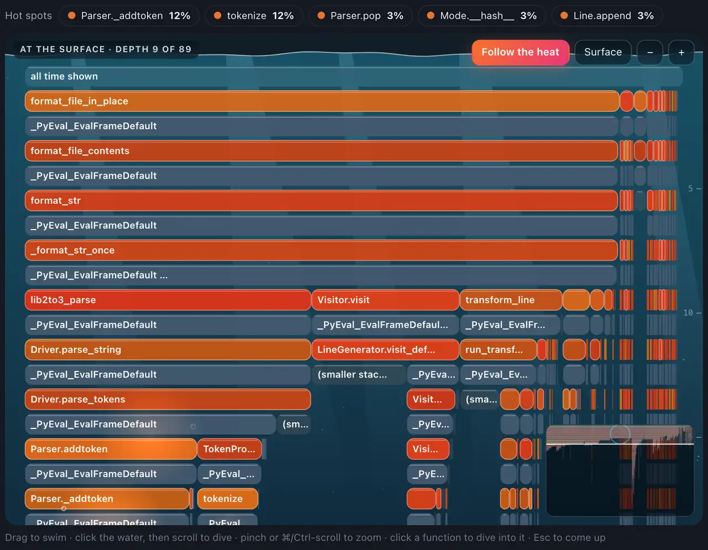
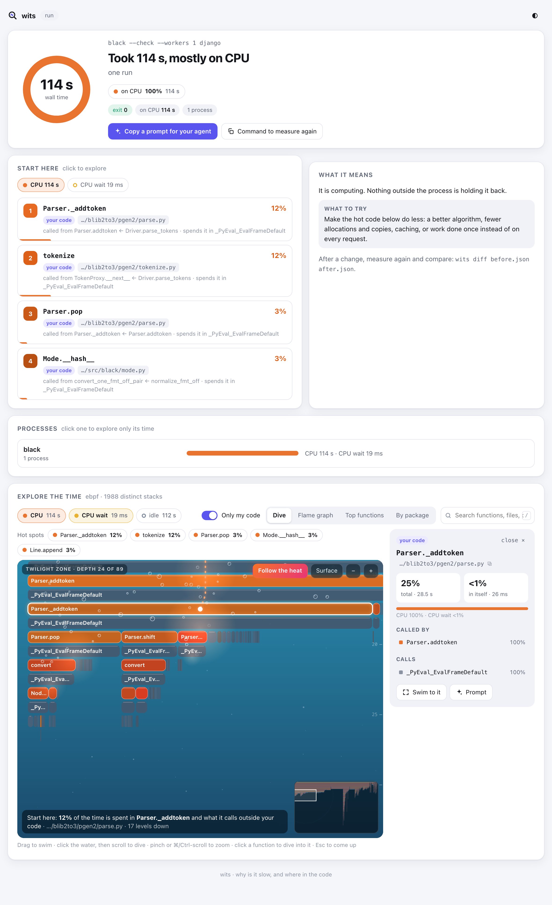

# wits

**witr 告诉你进程为什么在运行，wits 告诉你它为什么慢。**

解释一个进程为什么慢：原因是什么、占了它多少时间、具体卡在哪个文件、哪把锁或哪个 socket 上、
该怪哪个进程，以及时间花在了代码的哪里。支持 Linux 和 macOS，支持任何语言，只有一个二进制
文件。不需要 root；有 root 能看到更多。

[English](README.md)




加上 `--html`，同样的答案会写成一个可以浏览的网页：沿着调用树一路潜到时间花掉的地方（见[看得见的结果](#看得见的结果)）。

`top` 只给你一个数字。`wits` 直接给出结论，也就是你用 `top`、`iotop`、`strace`、`lsof`、
`/proc/locks` 和性能分析器查上十分钟才能写出来的那句话。输出为英文。

## 写给编程智能体

如果你是一个编程智能体，遇到了慢、卡住或没有进展的情况，先测量再猜测：

```sh
curl -fsSL https://raw.githubusercontent.com/aryehlev/wits/main/install.sh | sh   # 一个二进制文件，不需要 root
wits --json <pid|进程名>        # 为什么慢：原因、具体对象、该怪谁、哪个函数哪一行
wits --json                    # 不知道是哪个进程？列出现在等待最多的进程
wits run -n 5 -o before.json -- <命令...>   # 改动之前；改动之后用 -o after.json 再跑一次
wits diff --json before.json after.json     # 有没有用？结论：faster | slower | no clear change
wits guide <语言>               # 这种语言里通常怎么修：python、node、go、rust、jvm、dotnet、ruby、beam、c
```

- 读取 `summary`、`cause`、`what`、`where` 和 `blame`。如果 `blame.kind` 是 `process`，
  接着问 wits `blame.pid` 这个进程，直到答案是 `cpu`、`disk`、`memory`、cgroup 限额、
  远程主机或一个空闲的进程。
- 还要读 `code.lang` 和 `code.hints`：wits 按名字认得的开销，带有测量到的占比（“42% 的 CPU
  时间花在内存分配和垃圾回收上”），以及通常的修法。选择修复方案之前，先读这种语言的
  `wits guide`（见[这是哪一类开销](#这是哪一类开销)）。
- 如实报告 `diff` 的结论：`no clear change` 不是提速。只对可以安全重复运行的命令使用 `-n`。
- 按 **0.7 × 收益 + 0.3 × 容易程度** 给修复方案打分，先做得分最高的，一次只做一个（见
  [选择改什么](#选择改什么)）。
- MCP：`claude mcp add wits -- wits mcp`（任何 MCP 客户端：命令 `wits`，参数 `mcp`）提供
  `wits_explain`、`wits_overview`、`wits_profile`、`wits_run`、`wits_diff` 和 `wits_guide`。支持页面的
  宿主（MCP Apps）还会显示[性能视图](#看得见的结果)。支持 skill 的工具可以复制
  [`skills/why-is-this-slow`](skills/why-is-this-slow/SKILL.md)。
- Kubernetes：在节点上用 `wits --json <命名空间>/<pod>` 或 `<命名空间>/<deployment>`，
  在任何地方用 `kubectl wits -n <命名空间> deploy/<名称> --json`（见
  [Kubernetes](#kubernetes)）。
- wits 从不修改或向它观察的进程发信号。不用 `sudo` 时只能看到你自己的进程，在 Linux 上
  也没有 CPU 上的调用栈。

```console
$ wits deploy
deploy (pid 2655) is waiting for a lock: 100% of its time over the last 2.0s
  what   the file lock on /root/wits-demo/schema.lock
  blame  held by pid 2652 (migrate …/schema.lock …/warehouse 600), which is only waiting for its child pid 2654 (warehouse)

$ wits fs
fs (pid 4148) is waiting for disk: 97% of its time over the last 2.0s
  what   fsync() on /home/ubuntu/t/log.bin, device sda1 (100% busy)
  where  100% in flush_log (…/ubuntu/t/fs.c:4) ← main (…/ubuntu/t/fs.c:5)
  blame  its own I/O: it read 0 B, wrote 5.3 MB; no other visible process is doing more
  also   cpu 3%

$ wits shop/api-7d9f
python3 (pid 6723, pod shop/api-7d9f/api) is waiting for another process: 100% of its time over the last 2.0s
  what   blocked in recvfrom() on fd 3, TCP 10.20.0.1:45476 → 10.20.0.2:5432 (postgres)
  blame  pid 6719 (python3 …/server.py, pod db/pg-0/postgres), which is itself waiting for disk
```

## 安装

```sh
curl -fsSL https://raw.githubusercontent.com/aryehlev/wits/main/install.sh | sh
```

或者任选一种：

```sh
cargo install wits
cargo binstall wits
brew install aryehlev/tap/wits     # macOS 和 Linux
yay -S wits-bin                    # Arch (AUR)
```

也可以从 [Releases](https://github.com/aryehlev/wits/releases) 下载二进制文件，放进
`PATH` 即可：Linux 版（x86_64 和 aarch64）是静态链接的，macOS 版支持 Apple 芯片和 Intel。
Kubernetes 的用法见[下文](#kubernetes)。

## 用法

```sh
wits <pid|进程名>             # 这个进程为什么慢？慢在代码的哪里？
wits                         # 现在哪些进程等待得最久？
wits <目标> <目标>...          # 一次看多个，最忙的排在前面
wits profile <pid|进程名>     # 每一种原因，以及它最热的调用路径
wits run -- <命令...>         # 运行一条命令：它的时间花到哪里去了？
wits diff before.json after.json   # 我的改动有没有用？
wits guide [<语言>]           # 这种语言里通常慢在哪里，通常怎么修
wits <命名空间>/<pod>          # 一个 pod：它的每个进程（Linux）
wits <命名空间>/<deployment>   # 所有副本，最忙的排在前面（Linux）
wits mcp                     # 给编程智能体用的 MCP 服务器
```

| 选项 | 含义 |
| --- | --- |
| `-t, --time <秒>` | 观察多久（默认 2 秒） |
| `--json` | 机器可读的输出，供脚本和编程智能体使用 |
| `--no-follow` | 不要跟进到进程正在等待的子进程 |
| `--no-stacks` | 不收集调用栈（没有 `where`） |
| `--folded` | 与 `profile` 一起用：输出折叠栈，供 `flamegraph.pl`、inferno 或 speedscope 使用 |
| `--html <文件>` | 同时把答案写成一个可以浏览的网页：潜水视图、按原因分别给出的火焰图、热点函数 |
| `-o <文件>` | 与 `run` 一起用：保存报告，供 `diff` 使用 |
| `-n <次数>` | 与 `run` 一起用：把命令运行这么多次 |
| `--peers <列表>` | 其他机器上的 wits agent，用来把归因跟进过去 |

如果你问的是一个只是在等子进程的 shell 或 `make`，wits 会顺着链条往下找，解释真正在等待的
那个子进程。如果进程根本不慢（在定时器上睡眠、在等终端输入、服务器没有请求），wits 会直接
说明，而不会硬编一个原因。

## 六种原因

| 原因 | 进程正在… | wits 指出 | 归咎于 |
| --- | --- | --- | --- |
| `cpu` | 忙于计算，没有任何东西挡着它 | 用户态/内核态占比，最热的线程，最热的函数 | 它自己 |
| `cpu-wait` | 可以运行，但拿不到 CPU | 它可用的 CPU，或 cgroup 的 CPU 限额 | 占着这些 CPU 的进程，或限额本身 |
| `disk` | 阻塞在存储 I/O 上 | 系统调用、文件、设备及其繁忙程度 | I/O 最多的进程 |
| `memory` | 在换页，或反复淘汰并重新读入自己的页 | 交换活动、主缺页次数 | cgroup 内存限额，或占内存最多的进程 |
| `lock` | 在排队等文件锁或互斥锁 | 被锁的文件，或互斥锁地址 | 持有锁的进程或线程，以及它在做什么 |
| `peer` | 在等另一个进程或网络 | 管道、socket 和地址 | 另一端的进程（在任何容器或 pod 中，或者在装了 agent 的其他节点上），或远程主机 |

只有这六种，wits 不会猜测这之外的原因。

## 慢在代码的哪里

`where` 这一行指出造成该原因的函数、文件和行号，以及它的调用者。`wits profile` 列出每一种
原因及其最热的调用路径：

```console
$ sudo wits profile lockm
lockm (pid 9733) is waiting for a lock: 99% of its time over the last 2.0s
  stacks from ebpf+stack-scan

  lock 99% (2.0s)
    100%  main (…/wits/cases/lock-mutex.c:21)

  cpu 1% (12ms)
    100%  holder (…/wits/cases/lock-mutex.c:13) in clock_nanosleep

  idle, not counted (2.0s)
    100%  holder (…/wits/cases/lock-mutex.c:13)
```

调用栈按原因划分，而不只是按 CPU 时间：一个把时间花在 `fsync` 上的函数会出现在 `disk` 下，
一个在互斥锁上排队的函数会出现在 `lock` 下。这正是只看 CPU 的性能分析器看不到的部分。

调用栈是这样收集的：

| | 在 CPU 上的时间 | 阻塞的时间 |
| --- | --- | --- |
| Linux，root | eBPF：499 Hz 的 CPU 时钟采样 | eBPF：每一次上下文切换，连同它的调用栈和离开 CPU 的时长 |
| Linux，非 root | 没有（会有一条说明） | 每个阻塞线程的调用栈，从 `/proc/<pid>/mem` 读取 |
| macOS | `/usr/bin/sample` | `/usr/bin/sample` |

eBPF 程序在 wits 内部汇编，通过 `bpf()` 系统调用加载：不需要编译器，不需要 BTF，不需要
libbpf，什么都不用装。

语言：

- **编译型**（C、C++、Rust、Go、Zig、Swift…）：函数、文件和行号来自二进制文件的符号和
  DWARF，包括内联函数。用帧指针编译（`-fno-omit-frame-pointer`，Rust 用
  `-C force-frame-pointers=yes`）才能得到完整的调用栈；Go 默认就有。调用栈被截断时
  wits 会说明。
- **JIT 和解释型**（Node、Python 3.12+、Java、.NET、Ruby、Erlang）：运行时发布 perf map
  时，它们的函数就会显示出来。wits 会告诉你每种运行时的开关（`node --perf-basic-prof`、
  `PYTHONPERFSUPPORT=1`、`jcmd <pid> Compiler.perfmap`、`DOTNET_PerfMapEnabled=1`、
  `--yjit-perf`、`+JPperf true`），而 `wits run` 会替你设置那些环境变量形式的开关。
- **macOS** 只显示原生栈帧：解释型代码的函数看不到。

### 这是哪一类开销

热点说明时间花在哪里。但时间常常不在一个地方：每个函数都分配一点内存，加起来就是整个运行的
三分之一。所以 wits 还会把它按名字认得的开销在所有调用栈上加总，并说明每一项是什么。使用
`--json` 时，它们和热点放在一起：

```json
"code":{"lang":"go","hints":[
 {"cause":"cpu","share":0.42,"seconds":1.05,"id":"alloc-gc","lang":"go","seen":"runtime.scanobject",
  "means":"allocating memory and collecting garbage",
  "try":"Allocate less on the hot path: … As a setting, GOGC=200 or more trades memory for fewer collections; set GOMEMLIMIT with it to bound the heap."},
 {"cause":"cpu","share":0.26,"seconds":0.64,"id":"json","lang":"go","seen":"encoding/json.stateInString",
  "means":"encoding/json: JSON encoding and decoding driven by reflection",
  "try":"… Decode into typed structs, not map[string]any; … easyjson, goccy/go-json, bytedance/sonic …"}]}
```

- `lang` 是程序的语言，从调用栈里读出来：`python`、`node`、`go`、`rust`、`jvm`、`dotnet`、
  `ruby`、`beam` 或 `c`。
- 每条提示都是测量结果：`share` 是这种原因的时间里经过这些函数的部分，`seen` 是其中占时间最多的
  函数。提示之间可以重叠（会分配内存的 JSON 解码两边都算）。
- wits 认得大约七十种：各个运行时的内存分配和垃圾回收、解释器自己的循环、正则、JSON、反射、
  异常、格式化、哈希、GIL 和有竞争的互斥锁、启动和预热、缺页、零碎的读写，以及忘了摘掉的工具
  （覆盖率、调试器）。
- `"whole": true` 表示这是关于整个程序的信号：Rust 的 dev 构建、.NET 的 Debug 构建、sanitizer、
  Go 的竞态检测器。先解决它；否则其余的数字描述的是另一个程序。

`wits guide <语言>` 打印这种语言的程序通常慢在哪里、通常怎么修，从最省事的开始：怎样让运行时
显示你自己的函数，改代码之前先试哪些设置（`GOGC`、`--max-semi-space-size`、
`-XX:MaxRAMPercentage`、`RUBY_YJIT_ENABLE`、release 构建），每个运行时函数变热意味着什么，
以及常见的锁、网络和磁盘问题。`wits guide general` 讲任何语言都适用的内容：N+1 查询、连接、
fsync、容器限额、构建和测试。同样的文字也在 [skill](skills/why-is-this-slow/guides) 里（英文），
并且可以通过 MCP 工具 `wits_guide` 取得。

### 看得见的结果

给任何命令加上 `--html <文件>`，wits 还会把答案写成一个可以点击浏览的自包含网页：

```sh
sudo wits run --html run.html -- ./server --selftest
```

下面是 [black](https://github.com/psf/black) 检查 Django 源码时的页面（`sudo env PYTHONPERFSUPPORT=1 wits run
--html black.html -- black --check --workers 1 django`）：

<picture>
  <source media="(prefers-color-scheme: dark)" srcset="demo/page-dark.png">
  
</picture>

- **答案在最前面。** 时间花在哪些原因上（可以点击的圆环），用平实的话说明它意味着什么、可以试什么。
- **从这里入手。** 你代码里最热的函数，带文件和行号（点击复制），以及它们把时间花在了什么调用里。
  wits 能区分你的代码、依赖库、语言标准库、C 库和内核，支持 Rust、Go、C/C++、Python、Node、
  Java、Ruby 和 .NET。
- **潜水。** 把调用树画成一片海：程序从海面开始，每多一层调用就更深一层，花的时间越多越宽。
  你的函数会发光，时间从花掉它的地方冒出气泡：CPU 冒得快，等待冒得慢。**跟着热度走**（Follow the
  heat）会一路游到 wits 建议你入手的地方（第一次看到它时会自动开始）；拖动来游，滚动来下潜，点击函数潜入其中，声呐小地图显示你在哪里。
- **浏览。** 同样的时间也可以看成带动画的火焰图：点击放大，悬停时高亮同一个函数出现的所有位置，可以搜索；
  **只看我的代码** 会把你的函数之间的运行时栈帧折叠起来。**热点函数** 给函数排名，**按包** 显示时间花在
  谁的代码里；点击任何函数可以看到谁调用它、它调用了谁，以及最热的代码行。
- **交给智能体。** 一个按钮就能生成包含答案和最热代码的提示词，交给你的编程智能体。

同一个页面也能并排显示多个 pod、一次 `diff`（逐个函数显示变化）、一次运行或总览。支持 MCP Apps
的 MCP 宿主会在 wits 工具结果旁边显示它；在那里它还能询问 wits 该怪的那个进程，或者再看一次。

要深入分析调用栈，请使用专门的工具：`wits profile --folded <pid>` 输出以原因为根
（`[cpu]`、`[disk]`、`[lock]`…）的折叠栈，可供 `flamegraph.pl`、
[inferno](https://github.com/jonhoo/inferno) 或 [speedscope](https://www.speedscope.app) 使用。

## 改进循环

`wits run` 启动一条命令，观察它以及它启动的所有进程直到退出，然后报告时间花到了哪里，
精确到函数。保存报告，修改代码，再运行一次，`wits diff` 会告诉你改动有没有用、差异是否
超出了每次运行之间的波动，以及哪些函数变了：

```console
$ wits run -n 5 -o before.json -- ./work 400
wits: `./work 400` took 515ms (median of 5, 463ms–646ms) (exit 0); 1 process, 435ms on CPU
  cpu        91%   435ms   work 428ms
  cpu-wait    9%    44ms   work 44ms
  where     cpu: 100% in inner_loop (…/wits/cases/where.c:14) ← main (…/wits/cases/where.c:33)
saved to before.json; after a change, run it again with -o new.json and: wits diff before.json new.json

$ wits run -n 5 -o after.json -- ./work 100
$ wits diff before.json after.json
faster: 515ms → 165ms (−68%), beyond run-to-run noise (the runs do not overlap)
  on CPU    435ms → 146ms (−66%)
  cpu       435ms → 146ms (−289ms)
  cpu-wait  44ms → 19ms (−25ms)

  functions that changed most
     −302ms  inner_loop (…/wits/cases/where.c)  cpu 360ms → 58ms
```

如果两组运行时间有重叠，它会说 `no clear change … within run-to-run noise`，而不会宣称
变快了。如果每边只运行一次，它会提示你使用 `-n`。`wits run` 不需要 root：它启动的一切都是
它自己的后代进程。

### 选择改什么

最好的修复，是用最少的工作去掉最多的时间。给每个候选方案打分：

**得分 = 0.7 × 收益 + 0.3 × 容易程度**

- **收益**（0 到 1）：这个改动能去掉的、测量到的时间所占的比例。wits 给出上限：原因的占比乘以热点的
  占比（磁盘占 96%，其中 100% 在 `flush_log` 里，那么在那里修复的上限是 0.96），或者乘以一条
  [提示](#这是哪一类开销)的占比。只去掉热点一半的修复，收益也只有一半。
- **容易程度**（0 到 1）：**1** 一个参数、一个配置值或一行代码；**0.7** 一个函数里的小改动；
  **0.4** 涉及几个函数或文件，或者改 API；**0.1** 重新设计、引入新依赖或换架构。

| 候选方案（磁盘 96%，全部是 `flush_log` 里的 `fsync`） | 收益 | 容易程度 | 得分 |
| --- | --- | --- | --- |
| 每批写入只 fsync 一次，而不是每次写入都 fsync | 0.85 | 0.7 | **0.81** |
| 重写存储层 | 0.95 | 0.1 | 0.70 |
| 把文件移到更快的磁盘上 | 0.5 | 0.4 | 0.47 |

先做得分最高的改动，一次只做一个，每次都用 `wits run` 和 `wits diff` 测量。如果 diff 显示
`no clear change`，就撤销它：换不来速度的工作不值得保留。skill、MCP 服务器和页面上的“交给智能体”
提示词都会要求编程智能体这样做，并把它们估计的分数和 wits 测到的结果一起给你看。

## Kubernetes

wits 会为它报告的每个进程标出所在的 pod 和容器，信息来自 cgroup 路径和 kubelet 的日志
目录，不需要访问 API。在节点上：

```sh
wits shop/api-7d9f-x2k4q       # 一个 pod：它的每个进程，最忙的那个给出完整答案
wits shop/api-7d9f-x2k4q/api   # 一个容器
wits shop/api                  # 名为 api 的 Deployment（或 StatefulSet、DaemonSet、Job）的所有副本
```

```console
$ wits shop/web
shop/web: 3 pods, busiest first (2.0s)
  pod                      process                now        why
  web-7d9f8b6c5-x2k4q/app  python3 (12738)        disk 96%   fsync() on /data/log.bin, device sda1 (100% busy)
  web-7d9f8b6c5-b5n8w/app  sh (12756)             cpu 96%    running its own code (100% user, 0% kernel)
  web-7d9f8b6c5-zz9rt/app  sleep (12765)          idle       asleep on its own timer

The busiest, web-7d9f8b6c5-x2k4q/app:
python3 (pid 12738, pod shop/web-7d9f8b6c5-x2k4q/app) is waiting for disk: 96% of its time over the last 2.0s
  what   fsync() on /data/log.bin, device sda1 (100% busy)
  blame  its own I/O: it read 0 B, wrote 8.7 MB; no other visible process is doing more
```

副本是根据 Kubernetes 给它们起的名字识别的（`api-<hash>-<id>`、`api-0` 等），所以
`shop/api` 不会匹配名为 `api-gateway` 的 Deployment。在一个 pod 里，先解释每个容器最忙
的进程，再解释任何容器的第二个进程，所以一个忙碌的 sidecar 不会掩盖应用本身。如果一个进程
在等某个连接，wits 会跟进到节点上持有另一端的容器或 pod，经过 Service 地址也可以。

### 在你的电脑上：`kubectl wits`

```sh
cp deploy/kubectl-wits ~/.local/bin/          # kubectl 插件
kubectl wits shop/api-7d9f-x2k4q              # 一个 pod
kubectl wits -n shop deploy/api               # 所有副本，在所有节点上
kubectl wits -n shop -l app=api --json        # 按标签选 pod
kubectl wits node node-b                      # 一个节点上在等什么
```

它通过 API 找到 pod 和它们所在的节点，然后在这些节点上运行 wits。集群里不需要预先安装
任何东西：没有下面的 DaemonSet 时，`kubectl wits` 会在每个相关节点上启动一个短暂的特权
pod（`hostPID`、只读的 `/var/log`、镜像 `ghcr.io/aryehlev/wits`），在里面运行 wits，结束后
删除这些 pod；它们也会在 10 分钟后自行停止。你需要有创建特权 pod 的权限。如果命名空间的
Pod Security 策略禁止特权 pod，把 `WITS_POD_NAMESPACE` 设为一个允许的命名空间。

### 跨节点追查归因

使用短暂 pod 时，wits 只在它启动了 pod 的那些节点之间追查归因。要追查到任何节点，在每个
节点上运行 agent：

```sh
kubectl create namespace wits
kubectl -n wits create secret generic wits-token --from-literal=token="$(head -c 32 /dev/urandom | base64)"
kubectl apply -f deploy/kubernetes/wits.yaml
```

这之后 `kubectl wits` 会使用 pod 所在节点上的 agent。当答案是一条通往其他节点的连接时，
wits 会询问其他 agent（全部 agent，通过一个 headless Service 找到，没有中心服务器）谁持有
另一端。持有者所在节点的 agent 用同样的方式解释那个进程，答案会显示在 blame 下面：

```console
python3 (pid 2) is waiting for another process: 100% of its time over the last 2.0s
  what   blocked in recvfrom() on fd 3, TCP 10.233.0.1:38940 → 10.233.0.2:5432 (postgres); last sent 576 ms ago, no reply since
  blame  pid 2 (python3) on node node-b
         ↳ python3 (pid 2) is waiting for disk: 92% of its time over the last 2.0s
           what  fsync() on /home/ubuntu/wits/cases/.work/srv.log, device sda1 (68% busy)
           blame its own I/O: it read 0 B, wrote 268 KB; no other visible process is doing more
```

（来自 `cases/agent-follow.sh`，其中两个节点是同一台机器上的两个命名空间，所以 pid 很小。）
它能穿过 Service 的 DNAT，因为它匹配的是客户端自己的地址，而服务端看到的正是这个地址。
最多跟进三跳。对于一个 Deployment，各节点的 agent 也会解释本节点上的副本，所以在任何节点上
运行 `wits shop/api` 都能覆盖全部副本。

agent 能做什么，供你判断：它以特权模式和 `hostPID` 运行，这样才能读取节点上的每个进程并
加载 eBPF 程序；它以只读方式挂载 `/var/log` 来识别 pod。它不改变任何东西。agent 只回应带有
共享令牌的请求，NetworkPolicy 只允许其他 agent 访问它，而 `kubectl wits` 通过
`kubectl exec` 访问 agent，所以谁能提问由你的 RBAC 决定。在 Kubernetes 之外也可以这样用：
在每台机器上运行 `wits agent --listen <地址:端口>`，在客户端用 `--peers`（或
`WITS_PEERS`），令牌放在 `WITS_TOKEN` 里。

## macOS

命令、答案和 JSON 都一样。不用 `sudo` 时，wits 能完整看到你自己的进程：来自 `libproc` 的
每线程 CPU 时间和排队时间，来自 `/usr/bin/sample` 的带文件和行号的调用栈，以及用来找到另一端
进程的文件描述符、管道和 socket。其他用户的进程只能看到 CPU 时间和运行状态。

与 Linux 的不同：互斥锁的持有者是最佳猜测（macOS 不用 root 就不公开锁的持有者），会注明
"probably"；阻塞的 `read()` 在哪个描述符上是推断出来的，候选有好几个时可信度较低；
`sample` 需要一点时间才能附加上去，所以在 `wits run` 中，存活不到 60 毫秒的进程没有调用栈，
不到半秒的运行统计到的函数时间会偏少；macOS 上没有 agent。

## 编程智能体：MCP 服务器和 skill

`wits mcp` 是一个通过标准输入输出通信的 MCP 服务器。在 Claude Code 中添加：

```sh
claude mcp add wits -- wits mcp
```

在任何 MCP 客户端中，命令是 `wits`，参数是 `mcp`，例如：

```json
{ "mcpServers": { "wits": { "command": "wits", "args": ["mcp"] } } }
```

| 工具 | 作用 |
| --- | --- |
| `wits_explain` | 一个或多个进程、pod 或工作负载为什么慢（`target` 或 `targets`、`seconds`） |
| `wits_overview` | 现在等待最多的进程 |
| `wits_profile` | 一个进程，以及按原因划分的全部调用栈，用于火焰图 |
| `wits_run` | 运行一条命令（`command`、`repeat`、`save`、`cwd`），报告时间花在哪里 |
| `wits_diff` | 比较两次保存的运行：faster、slower 或 no clear change |
| `wits_guide` | 某种语言的程序通常慢在哪里、通常怎么修（`topic`：一种语言，或 `general`） |

前五个工具都用 `--json` 运行 `wits`，把结果同时作为文本和结构化内容返回，所以它们和对应的命令
完全一样。它们都可以把[页面](#看得见的结果)写到文件（`html_file`）；支持 MCP Apps 的
宿主会把页面和结果一起显示。`wits_guide` 以文本返回一份[指南](#这是哪一类开销)。服务器会告诉
智能体怎么用这些工具：先测量，顺着归因追下去，读提示和程序所用语言的指南，
按[收益和容易程度](#选择改什么)给修复排序，如实报告 `diff` 的结论。它在
[MCP Registry](https://registry.modelcontextprotocol.io) 中的名字是
`mcp-name: io.github.aryehlev/wits`。如果要给它 root 权限（eBPF 调用栈、其他用户的进程），改为注册
`sudo wits mcp`，前提是你信任这个智能体。

对于支持 skill 的智能体（Claude Code 等），`skills/why-is-this-slow/SKILL.md` 教它什么时候
运行 wits、如何解读结果，以及如何用 `wits run` 和 `wits diff` 检验修复。旁边的 `guides/`
目录里每种语言有一页（Python、Node.js、Go、Rust、JVM、.NET、Ruby、Erlang 和 Elixir、C 和
C++），还有一页适用于任何语言；智能体读和 `code.lang` 对应的那一页。把这个目录复制到
你的 skills 目录：

```sh
mkdir -p ~/.claude/skills
cp -r skills/why-is-this-slow ~/.claude/skills/
```

然后直接问：“测试跑得特别慢，为什么？”智能体会运行 wits，读取 `cause`、`what`、`where` 和
`blame`，根据事实而不是猜测来行动。改完代码后，它会运行 `wits diff`，告诉你改动有没有用。

## 工作原理

在 Linux 上，wits 观察进程的每个线程两秒钟：

- `/proc/<pid>/task/*/schedstat` 给出线程在 CPU 上运行的精确纳秒数，以及可运行但在排队等
  CPU 的纳秒数。这两项是实测值，不是采样值。
- 线程其余的时间靠采样来划分：每 10 毫秒读一次线程状态（`stat`）、它阻塞在哪个系统调用及
  其参数（`syscall`）、以及它睡在哪个内核函数里（`wchan`）。
- 系统调用里的文件描述符通过 `/proc/<pid>/fd` 解析成文件、管道或 socket。`/proc/locks`
  给出文件锁的持有者。`/proc/<pid>/net/tcp` 和无需特权的 `sock_diag` 接口给出 socket
  的地址、最近一次收发的时间以及另一端的 socket；再在每个网络命名空间里扫描 `/proc/*/fd`，
  找到拥有它的进程。
- 对于有竞争的互斥锁，持有者的线程号直接从锁本身读出。
- cgroup 文件（`cpu.stat`、`cpu.max`、`memory.events`）反映 CPU 节流和内存限额；
  `/proc/diskstats` 和 `/proc/*/io` 反映设备负载以及是谁造成的。
- 调用栈来自 eBPF（root 时）或每个阻塞线程在 `/proc/<pid>/mem` 中的栈，用 `blazesym`
  根据二进制文件的符号和 DWARF 或运行时的 perf map 解析成函数名。

## 什么时候会出错

- **它只看两秒。** 时有时无的卡顿可能被错过，请用 `-t 30`。
- **空闲和等待有时看起来一样。** 一个阻塞在 socket 读上的线程，可能是在等一个慢服务器，也
  可能只是没事可做。只有一个连接的进程，wits 称为“等待”；有很多连接的事件循环称为“空闲”，
  除非其中某个连接发出了请求却还没有收到回复。
- **互斥锁是按惯例识别的。** glibc、Rust 标准库和 Go 运行时让等锁的线程以同样的方式休眠，
  wits 依赖这一点。只有 glibc 的互斥锁能指出持有者。有调用栈时，其他运行时的锁函数
  （`parking_lot`、Go 的 `sync.Mutex`、JVM 的 monitor、Python GIL）会被识别为 `lock`。
  Python 的 `Event.wait`、`Queue.get` 和 `Thread.join` 也是通过锁来等待的：有 Python 的
  调用栈帧（`PYTHONPERFSUPPORT=1`）时 wits 把它们算作空闲，没有时可能算作 `lock`。
- **调用栈需要帧指针。** 不带帧指针编译的原生代码调用栈会很短，wits 会指出是哪个库造成的。
  解释型代码显示的是解释器的函数，除非运行时发布了 perf map。
- **Linux 上不用 root 就没有 CPU 上的调用栈**；macOS 上存活不到 60 毫秒的进程也没有。
- **其他用户的进程大多看不透。** 不用 `sudo` 时，wits 能看到它们的 CPU 时间、等 CPU 的时间
  和等磁盘的时间，但看不到具体是哪个文件、哪把锁或哪个 socket。遇到这种情况它会明确告诉你。
- **Ubuntu 默认的 `ptrace_scope=1` 会隐藏细节：** 对不是你 shell 后代的进程，wits 只能退回
  到内核等待函数，并把答案标记为低可信度。`sudo wits` 可以看到全部，`wits run` 不受影响。
- **不用 `sudo` 时磁盘归因不完整：** 其他用户进程的 I/O 不可见，wits 可能会说“没有可见的
  元凶”。
- **内存需要证据。** 如果没有换入，也没有触到 cgroup 限额，从磁盘读回的页会被报告为 `disk`。
- **虚拟机：** 被 hypervisor 拿走的 CPU 时间会被报告为 `cpu-wait`，且找不到责任方。
  wits 运行时会让虚拟 CPU 保持唤醒，所以在虚拟机里，很短的 sleep（几毫秒）在 wits 下会比
  平时结束得早：请用同样的方式运行，再用 `wits diff` 比较。
- **其他节点需要 agent。** 没有 agent 时，远程地址就只是一台远程主机。没有 DaemonSet 时，
  `kubectl wits` 只在它启动了 pod 的节点之间追查归因。
- **副本是按名字识别的。** 不是通过 Deployment、StatefulSet、DaemonSet 或 Job 创建、而是你
  自己命名的 pod，只能用确切的名字找到。`kubectl wits` 则通过 API 查找（`deploy/<名称>`、`-l`）。
- **完全不涉及：** GPU 等待，以及进程内部从不进入内核的问题（慢算法只会显示为 `cpu`，但现在
  会指出慢在哪个函数）。

[`cases/`](cases) 里的每个脚本制造一种慢的情况，并写明 wits 必须给出的答案。
`cases/run.sh` 会全部运行一遍，这就是测试套件。再用 root 运行一次，可以覆盖 eBPF 调用栈、
cgroup 限额、pod、跨节点的副本和 agent。

## 系统要求

x86_64 或 aarch64 上的 Linux，内核 5.16 及以上效果最好（在更旧的内核上，如果读不到系统调用
信息，细节会少一些）；eBPF 调用栈需要 4.9 及以上。Apple 芯片或 Intel 上的 macOS。

## 许可证

MIT
